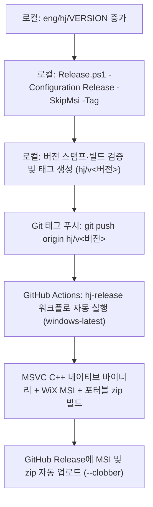

# Git Extensions 포크(hj) 릴리스 가이드

본 문서는 Git Extensions hj 포크의 버전 명명 규칙, 릴리스 스크립트 실행 절차, GitHub Actions CI 릴리스 워크플로 및 빌드 환경 제약 사항을 설명합니다.

---

## 1. 버전 형식

- **문자 버전 (Informational/Display)**: `<BUILD_VERSION_BASE>-hj-<HjNumber>` (예: `7.3.0-hj-1`)
- **숫자 버전 (Assembly/File Version)**: `<BUILD_VERSION_BASE>.<HjNumber>` (예: `7.3.0.1`)
- **Git 태그 형식**: `hj/v<문자버전>` (예: `hj/v7.3.0-hj-1`)
- **업스트림 기준 버전 추종**: 기준 번호는 업스트림 워크플로(`.github/workflows/_app-build-core.yml`)의 `BUILD_VERSION_BASE`(현재 `7.3.0`)를 정규식으로 자동 추출하므로, 업스트림이 버전 번호를 올리면 자동으로 추종합니다.
- **태그 보존 특성**: Git 태그는 `hj/main`의 특정 커밋 객체에 고정(annotated tag)됩니다. 향후 새 동기화로 인해 `hj/main` 브랜치가 `master`에서 다시 생성되고 커밋 SHA가 달라지더라도, 이전에 부여된 태그는 불변(immutable)으로 유지되어 이전 빌드와 릴리스 지점을 영구적으로 보존합니다.

---

## 2. 릴리스 흐름 개요

포크 릴리스는 **(1) 로컬 검증 및 태그 생성**과 **(2) GitHub Actions 자동 빌드 및 릴리스 배포**의 2단계로 진행됩니다.



---

## 3. 상세 릴리스 절차

### 1단계: 로컬 준비 및 태그 생성

새 릴리스를 제작하고 배포할 때는 다음 표준 절차를 순서대로 진행합니다:

1. **업스트림 동기화 및 `hj/main` 통합**:
   - 릴리스에 앞서 최신 업스트림 및 토픽 브랜치들의 통합 브랜치(`hj/main`)를 생성/갱신합니다:
     ```pwsh
     pwsh eng/hj/Sync-Upstream.ps1
     ```
   - 동기화 완료 후 통합 브랜치인 `hj/main`으로 체크아웃합니다:
     ```sh
     git checkout hj/main
     ```
2. **포크 버전 번호 증가**:
   - `eng/hj/VERSION` 파일을 열고 버전 번호를 1 증가시킵니다. (예: `1` -> `2`)
3. **릴리스 패키징 및 태그 생성 (`Release.ps1`)**:
   - Visual Studio Build Tools 2026이 갖춰진 환경에서는 `Release.ps1` 실행 시 네이티브 바이너리와 MSI 패키지가 기본으로 함께 빌드됩니다:
     ```pwsh
     pwsh eng/hj/Release.ps1 -Configuration Release -Tag
     ```
   - C++ 도구나 WiX가 없거나 포터블 zip만 제작할 때는 `-SkipMsi` 옵션을 지정합니다:
     ```pwsh
     pwsh eng/hj/Release.ps1 -Configuration Release -SkipMsi -Tag
     ```
   - 어셈블리 빌드 및 버전 주입만 검증할 때는 `-SkipPublish`를 사용할 수 있습니다:
     ```pwsh
     pwsh eng/hj/Release.ps1 -Configuration Release -SkipPublish
     ```
   - 작업 트리에 커밋되지 않은 변경 사항이 있을 때는 `-AllowDirty`를 추가합니다.
   - `-Tag` 옵션은 현재 커밋에 `hj/v<BUILD_VERSION_BASE>-hj-<HjNumber>` 태그를 부착하며, 태그 메시지에 업스트림 베이스(`upstream-base: <merge-base commit>`) 정보를 자동으로 기록합니다.
4. **로컬 산출물 및 스탬프 원복 확인**:
   - 포터블 패키지 zip: `artifacts/Release/publish/GitExtensions-Portable-x64-<BUILD_VERSION_BASE>.<HjNumber>-hj-<HjNumber>-<GitCommit>.zip` (예: `GitExtensions-Portable-x64-7.3.0.1-hj-1-b8c365975.zip`)
   - 컴파일된 실행 파일: `artifacts/Release/bin/GitExtensions/net10.0-windows/GitExtensions.exe` 및 `GitExtensions.dll`
   - 버전 정보 확인:
     ```pwsh
     (Get-Item artifacts/Release/bin/GitExtensions/net10.0-windows/GitExtensions.dll).VersionInfo
     ```
   - 스탬프 원복 확인: 스크립트 실행 후 `git status --porcelain`에 `CommonAssemblyInfo.cs`나 서브모듈의 변경 사항이 남지 않고 원복되었는지 확인합니다.
5. **원격 푸시 및 GitHub Release 업로드**:
   - 생성된 태그와 `hj/main`을 원격 저장소에 푸시합니다:
     ```sh
     git push origin hj/main
     git push origin <태그명>
     ```
   - 태그를 푸시하면 2단계의 GitHub Actions 워크플로가 MSI·포터블 zip을 빌드해 Release에 첨부합니다. 로컬 zip을 따로 올릴 필요는 없습니다.

### 2단계: GitHub Actions 릴리스 배포

1. **태그 푸시 (자동 트리거)**:
   - 로컬에서 생성된 태그를 원격 포크 저장소(`origin`)로 푸시합니다:
     ```pwsh
     git push origin hj/v<문자버전>
     ```
   - 태그가 푸시되면 포크 전용 GitHub Actions 워크플로(`.github/workflows/hj-release.yml`)가 자동으로 실행됩니다.
   - `windows-latest` 러너에서 다음 과정이 자동으로 진행됩니다:
     - Visual Studio MSVC 도구 체인을 사용한 C++ 네이티브 구성 요소 빌드 (`src/native/build.proj` -> `GitExtensionsShellEx` 셸 확장 dll, `GitExtSshAskPass` exe)
     - .NET Release 빌드
     - WiX 도구를 사용한 정식 설치 패키지(MSI) 및 포터블 zip 패키징
     - GitHub Release 생성(없는 경우) 및 산출물 첨부 (`gh release upload --clobber`)
     - 로컬에서 먼저 업로드한 동일 이름의 zip 파일이 있더라도 `--clobber` 옵션에 의해 Actions가 새로 빌드한 패키지로 자동 교체됩니다.
2. **수동 재실행 (workflow_dispatch)**:
   - 기존 태그에 대해 빌드를 다시 수행하거나 산출물을 다시 붙여야 할 경우, GitHub 저장소 **Actions** 탭에서 `hj-release` 워크플로를 선택하고 **Run workflow**를 실행합니다:
     - `tag`: 릴리스할 태그 이름 지정 (예: `hj/v7.3.0-hj-1`, 필수)
   - **주의**: GitHub 은 워크플로 파일이 **기본 브랜치**에 있을 때만 수동 실행(Run workflow)을 허용합니다. 포크의 기본 브랜치가 업스트림 미러인 `master` 이면 이 버튼이 나타나지 않으므로, 저장소 Settings → General → Default branch 를 `hj/main` 으로 바꿔 두어야 합니다.
   - 태그 푸시로 실행될 때는 **태그가 가리키는 커밋의** 워크플로 파일이 쓰입니다. 이 워크플로가 생기기 전의 태그(`hj/v7.3.0-hj-1`)는 태그 푸시로는 실행되지 않으며 수동 실행으로만 다시 빌드할 수 있습니다.

---

## 4. 코드 서명(Code Signing) 및 보안 경고 안내

- **서명 미적용 안내**:
  - 업스트림 Git Extensions 릴리스에 적용되는 SignPath 코드 서명은 포크 환경에는 인증서가 없으므로 적용되지 않습니다.
  - 따라서 GitHub Actions에서 생성된 MSI 설치 파일 및 바이너리는 디지털 서명이 되어 있지 않습니다.
- **Windows SmartScreen 경고**:
  - 서명되지 않은 설치 파일이므로 Windows에서 실행 시 SmartScreen 필터 경고 화면("Windows의 PC 보호")이 표시될 수 있습니다.
  - 실행 시 **'추가 정보'** 클릭 후 **'실행'**을 선택하여 설치를 진행할 수 있습니다.

---

## 5. 포크 저장소 GitHub Actions 설정 및 주의 사항

1. **Actions 활성화**:
   - 포크 저장소(`5solas/gitextensions`)에서 GitHub Actions를 처음 사용하는 경우 기본적으로 Actions가 비활성화되어 있을 수 있습니다.
   - 저장소 **Settings → Actions → General**의 **Actions permissions** 항목에서 **"Allow all actions and reusable workflows"**를 선택하고 저장해야 워크플로가 정상 실행됩니다.
2. **업스트림 CI 워크플로 비활성화 권장**:
   - 업스트림 저장소에서 상속된 CI 워크플로(`.github/workflows/app-build.yml` 등)는 포크의 `master` 브랜치 push나 PR 시에도 자동 실행될 수 있습니다.
   - 불필요한 빌드 시간 및 GitHub Actions 사용량(쿼터) 낭비를 방지하려면 저장소 **Actions** 탭에서 해당 워크플로(`App build` 등)를 선택하고 우측 상단의 `...` 메뉴에서 **Disable workflow**를 선택해 비활성화할 수 있습니다.

---

## 6. 로컬 환경의 네이티브 및 MSI 빌드 지원 (참고)

로컬 머신에 Visual Studio 또는 Visual Studio Build Tools 2026이 설치되어 있으면 로컬에서도 C++ 네이티브 구성 요소 및 WiX MSI 설치 패키지를 빌드할 수 있습니다.

### 필수 도구 및 설치 명령 (winget)

Visual Studio Build Tools 2026을 사용하여 로컬 네이티브 바이너리 및 MSI를 빌드하려면 C++ 빌드 도구 워크로드뿐만 아니라 **C++ ATL 컴포넌트(`Microsoft.VisualStudio.Component.VC.ATL`)**가 반드시 포함되어야 합니다 (`GitExtensionsShellEx` 및 `GitExtSshAskPass` 빌드에 ATL 필수).

- **Build Tools 신규 설치 (관리자 권한 PowerShell)**:
  ```pwsh
  winget install Microsoft.VisualStudio.BuildTools --override "--quiet --wait --add Microsoft.VisualStudio.Workload.VCTools --add Microsoft.VisualStudio.Component.VC.ATL --includeRecommended"
  ```
- **기존 Build Tools에 ATL 구성 요소 추가 (관리자 권한 PowerShell)**:
  ```pwsh
  & "${env:ProgramFiles(x86)}\Microsoft Visual Studio\Installer\setup.exe" modify --installPath "C:\Program Files (x86)\Microsoft Visual Studio\18\BuildTools" --add Microsoft.VisualStudio.Component.VC.ATL --passive
  ```

### 로컬 빌드 동작 방식

1. **네이티브 C++ 바이너리 자동 감지 빌드**:
   - `Release.ps1`은 `vswhere`를 통해 `Microsoft.VisualStudio.Component.VC.Tools.x86.x64`를 확인합니다.
   - 도구가 감지되면 .NET 솔루션 빌드 전에 `src/native/build.proj`를 자동 복원·빌드하여 `GitExtSshAskPass.exe` 및 `GitExtensionsShellEx32/64.dll`을 생성합니다. 도구가 없으면 경고 후 네이티브 빌드를 건너뜁니다.
2. **설치 패키지(MSI) 자동 빌드 및 `-SkipMsi`**:
   - VS MSBuild 및 네이티브 산출물이 준비되어 있으면 `Release.ps1`은 기본적으로 MSI 설치 패키지를 생성합니다.
   - MSI 생성을 건너뛰고 포터블 zip만 생성하려면 명시적으로 `-SkipMsi` 옵션을 지정합니다.
3. **기본 릴리스 배포 경로 유지**:
   - 로컬에서 네이티브·MSI 빌드가 지원되더라도 공식 릴리스 배포는 태그 푸시를 통한 GitHub Actions CI(`hj-release.yml`)를 표준 경로로 유지합니다.
