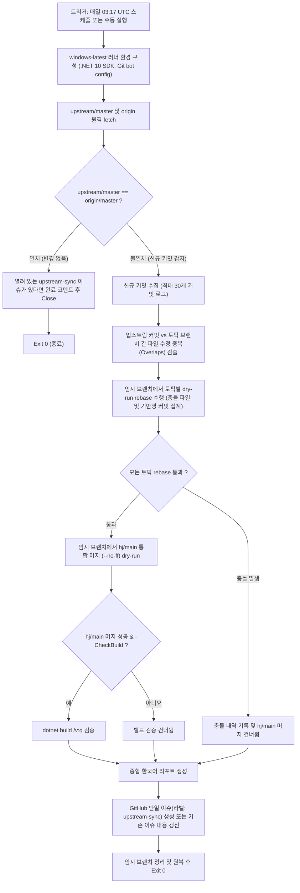

# Git Extensions 포크(hj) 업스트림 변경 감지기 (Upstream Watcher)

본 문서는 Git Extensions hj 포크의 업스트림(`upstream/master`) 변경 감지 및 패치 스택 자동 검증 워크플로(`.github/workflows/hj-upstream-watch.yml`)와 헬퍼 스크립트(`eng/hj/Watch-Upstream.ps1`)의 동작 원리 및 사용법을 설명합니다.

---

## 1. 개요 및 목적

- **목적**: 업스트림(`gitextensions/gitextensions`)의 `master` 브랜치가 전진했을 때, 포크(`5solas/gitextensions`)의 토픽 브랜치 패치 스택(`eng/hj/topics.txt`)이 최신 업스트림 위에 여전히 충돌 없이 rebase 및 머지되는지 매일 자동으로 검증합니다.
- **비파괴 검증 원칙 (Non-destructive)**:
  - 감지기는 어떠한 브랜치도 push, force-push, tag 또는 release하지 않습니다.
  - 모든 rebase 및 merge 검증은 완전히 격리된 임시 브랜치(`tmp/watch-*`)에서만 수행되며, 검증 완료 즉시 임시 브랜치와 작업 트리를 원복합니다.
  - 실 브랜치(`master`, `hj/main`, 토픽 브랜치)의 포인터는 단 1비트도 변경되지 않습니다.

---

## 2. 워크플로 구성 및 아키텍처



### 2.1 트리거 및 동시성 제어
- **스케줄 트리거**: 매일 03:17 UTC (`cron: '17 3 * * *'`). 정시(:00)에 집중되는 GitHub Actions 러너 큐 부하를 분산하기 위해 17분을 선택했습니다.
- **수동 실행 (`workflow_dispatch`)**:
  - `base_ref`: 테스트 또는 과거 커밋 시뮬레이션을 위한 기준 커밋 SHA/ref (기본값: 공백 -> `origin/master`).
  - `check_build`: 솔루션 빌드 검증 수행 여부 (기본값: `true`).
- **권한 (`permissions`)**: `contents: read, issues: write` (이슈 생성 및 갱신에 최소 권한 부여).
- **동시성 (`concurrency`)**: `group: hj-upstream-watch`, `cancel-in-progress: false` (실행 중복 방지).
- **작업 제한 시간**: `timeout-minutes: 60`.

### 2.2 단일 이슈 리포팅 및 멱등성 (Idempotency)
- 감지 결과는 레이블 `upstream-sync`가 부여된 **단 하나의 GitHub 이슈**로 관리됩니다.
- 이미 열려 있는 이슈가 있다면:
  - 새로운 이슈를 중복 생성하지 않고 기존 이슈의 제목과 본문을 최신 검증 결과로 업데이트(`gh issue edit`)합니다.
  - 새 커밋 반영 알림 코멘트(`gh issue comment`)를 1회 추가합니다.
- 업스트림이 이미 `origin/master`와 일치하는 상태라면:
  - 기존에 열려 있던 `upstream-sync` 이슈를 자동으로 닫고(`gh issue close`) 완료 코멘트를 남깁니다.
- 동일한 업스트림 SHA로 워크플로가 여러 번 실행되어도 중복 이슈가 생성되지 않습니다.

### 2.3 조기 경보 신호 (File Overlaps)
- 업스트림 신규 커밋들이 수정한 파일 목록과 포크 토픽 브랜치들이 수정한 파일 목록 간 교집합을 계산합니다.
- Git 머지 단계에서 충돌 마커가 발생하지 않더라도, 업스트림이 우리가 커스텀 수정한 클래스의 내부 구현이나 API 시그니처를 변경했을 경우 잠재적 런타임 오류가 발생할 수 있습니다.
- Overlaps 목록은 이러한 영역을 사전 인지할 수 있도록 리포트 상단에 명시합니다.

---

## 3. 로컬 실행 및 시뮬레이션 방법

`eng/hj/Watch-Upstream.ps1` 스크립트는 로컬 개발 환경에서도 손쉽게 실행하여 업스트림 패치 스택 상태를 진단할 수 있습니다.

### 3.1 실 원격 기준 로컬 진단 (읽기 전용)
```pwsh
# GitHub 이슈 갱신 없이 로컬 콘솔에만 리포트 출력 (-NoIssue)
pwsh eng/hj/Watch-Upstream.ps1 -NoIssue

# 리포트를 파일로도 저장
pwsh eng/hj/Watch-Upstream.ps1 -NoIssue -ReportPath "artifacts/upstream-report.md"
```

### 3.2 신규 업스트림 커밋 시뮬레이션 (`-BaseRef`)
현재 `origin/master`가 이미 최신 `upstream/master`와 일치하여 신규 커밋 처리 로직을 검증하기 어려울 때는 `-BaseRef` 매개변수로 이전 커밋을 지정합니다:

```pwsh
# 업스트림 5개 커밋 전을 베이스로 가정하여 5개 신규 커밋에 대한 rebase/merge/overlap 검증
pwsh eng/hj/Watch-Upstream.ps1 -BaseRef upstream/master~5 -NoIssue

# 빌드 검증까지 포함하여 시뮬레이션
pwsh eng/hj/Watch-Upstream.ps1 -BaseRef upstream/master~5 -CheckBuild -NoIssue
```

---

## 4. 이슈 알림 수신 시 대처 절차

GitHub 이슈 알림을 받거나 리포트에서 충돌이 확인되면 개발자는 다음 단계에 따라 로컬에서 동기화를 진행합니다.

### 4.1 충돌이 없는 경우 (`✅ 모든 패치 스택 정상 적용 가능`)
패치 스택이 깨끗하게 적용되므로 즉시 로컬에서 표준 동기화 및 원격 푸시를 실행합니다:
```pwsh
# 작업 트리가 깨끗한 상태에서 실행
pwsh eng/hj/Sync-Upstream.ps1 -Push
```
푸시가 완료되면 다음 날 watcher 실행 시 `origin/master == upstream/master` 조건이 충족되어 열려 있던 GitHub 이슈가 자동으로 닫힙니다.

### 4.2 충돌이 발생한 경우 (`⚠️ 패치 스택 충돌 발생`)
1. 동기화 스크립트를 실행하여 충돌 위치에서 중단시킵니다:
   ```pwsh
   pwsh eng/hj/Sync-Upstream.ps1
   ```
2. 리포트의 **충돌 상세** 및 **Overlaps** 목록을 참고하여 충돌 파일을 수동으로 해결합니다:
   ```sh
   git add <해결된_파일>
   git rebase --continue
   ```
3. 모든 토픽 브랜치 rebase 및 `hj/main` 재생성이 완료되면 푸시합니다:
   ```pwsh
   pwsh eng/hj/Sync-Upstream.ps1 -Push
   ```
4. 특정 커밋이 업스트림에 완전 채택되어 빈 커밋이 된 경우(`Adopted (Empty)`), `eng/hj/topics.txt`에서 해당 토픽을 제외하거나 rebase drop 처리합니다.
